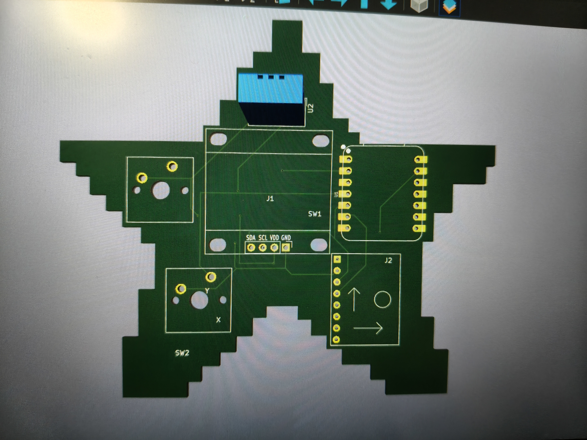

# Project-2
This is the Starbie PCB, it is a Printed Circuit Board
It contains multiple components such as the XIAO-ESP32-C3, the MPU-6050 and the DHT11 sensor
I chose to do this project as it was guided and much easier to learn everything from scratch, its relatively low complexity allows me to finish it

This is my PCB layout for the starbie, it contains the electrical wiring and connections for the board (the physical arrangement of components and connectors)
The blue connections means the electrical connections are at the back of the circuit while the red connections means the electrical connections are at the front of the circuit. Connections between components allow communication to occur, hence it is important to connect them according to their ports correctly such as GND to GND and not GND to 5V

This is my schematic layout, it defines the electrical circuit, you can see all the separate components and their pins(GND etc)

This is my 3d layout of the Starbie, it is a render of the PCB layout, it contains the electrical connections and components

FRONT VIEW:

BACK VIEW:

Assembling it requires the pins of correct components matched with the corresponding sections of the PCB, and to physically connect them requires soldering, which uses a soldering iron to melt a solder wire to allow electricity flow while physically sticking to each other

## Bill of Materials (BOM)

| Reference | Qty | Value | Footprint |
|---|---:|---|---|
| J1 | 1 | Conn_01x04_Pin | Imported Parts:Display_128x64_096_I2C |
| J2 | 1 | Conn_01x08_Pin | Imported Parts:MPU6050_Module |
| R1 | 1 | 10K | Resistor_THT:R_Axial_DIN0204_L3.6mm_D1.6mm_P7.62mm_Horizontal |
| SW1, SW2 | 2 | SW_Push | Button_Switch_Keyboard:SW_Cherry_MX_1.00u_PCB |
| U1 | 1 | XIAO-ESP32-C6-DIP | Imported Parts:XIAO-ESP32-C6-DIP |
| U2 | 1 | DHT11 | Sensor:Aosong_DHT11_5.5x12.0_P2.54mm |

