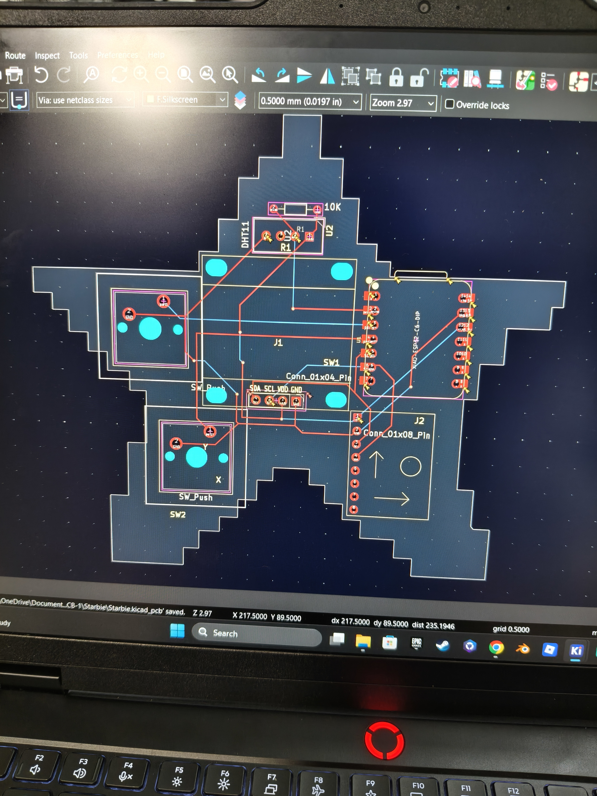
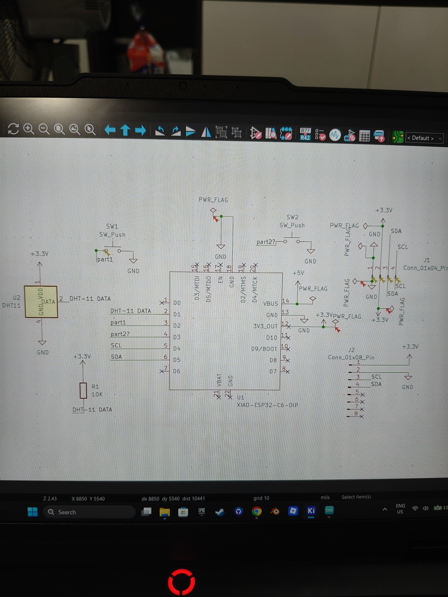
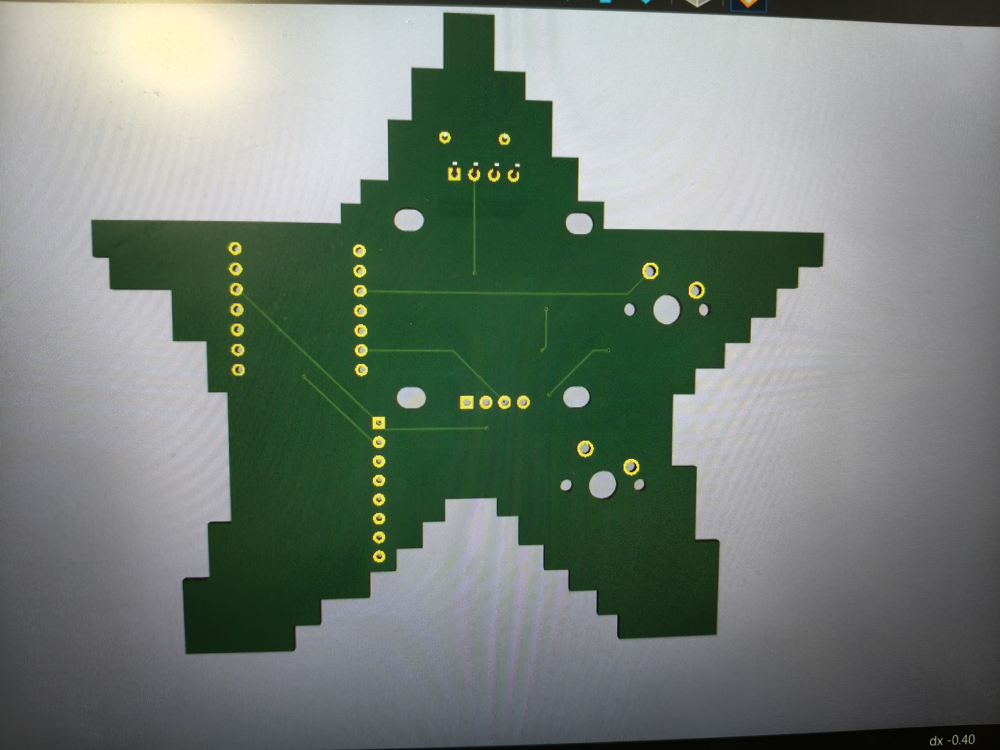

# Project-2
This is the Starbie PCB, it is a Printed Circuit Board
It contains multiple components such as the XIAO-ESP32-C3, the MPU-6050 and the DHT11 sensor

This is my PCB layout for the starbie, it contains the electrical wiring and connections for the board (the physical arrangement of components and connectors)(

This is my schematic layout, it defines the elcetrical circuit

This is my 3d layout of the Starbie, it is a render of the PCB layout, it contains the electrical connections and components

FRONT VIEW:

BACK VIEW:

